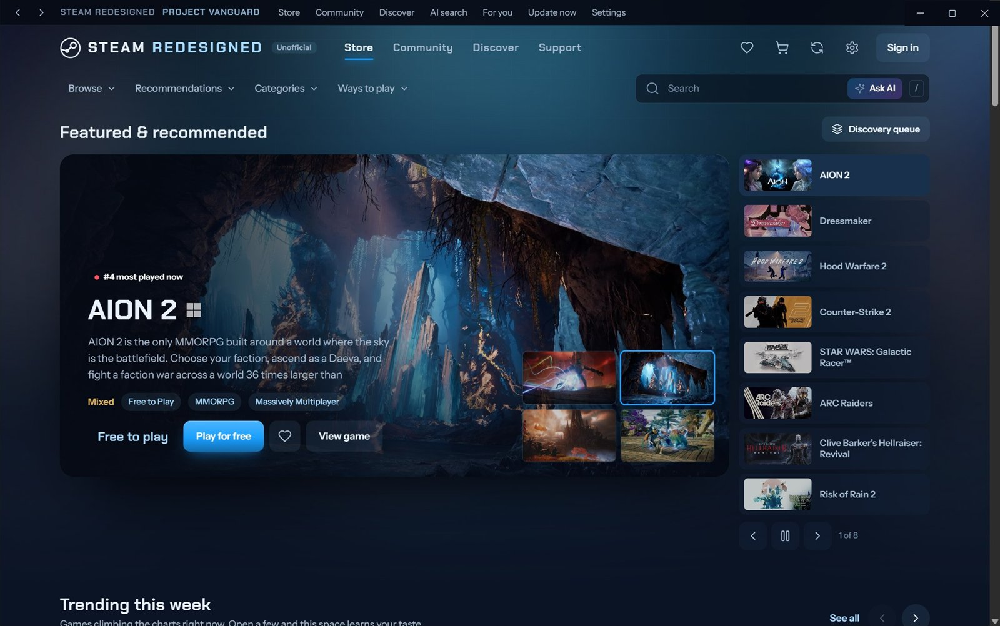
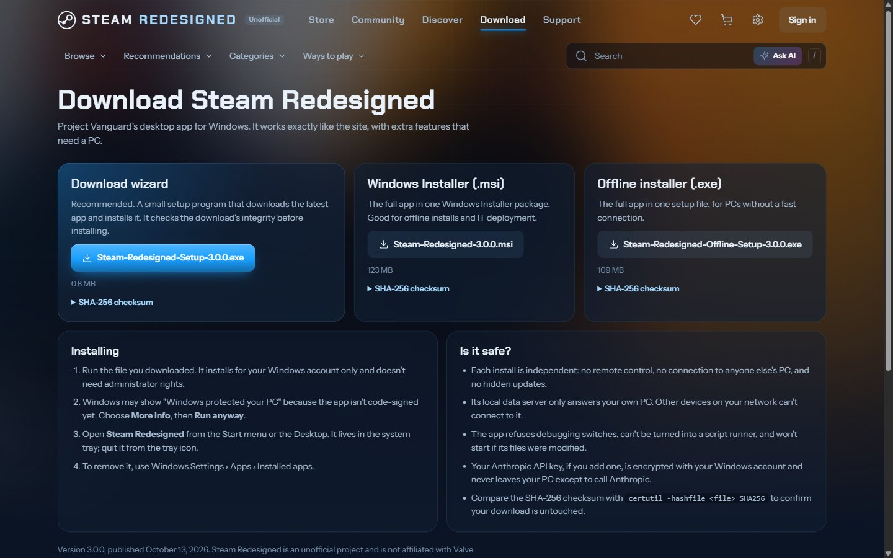

# Steam Redesigned (Project Vanguard)

An unofficial redesign of the Steam store and community, running on live Steam data. Use it as a Windows desktop app, an Android app or in your browser (BETA VERSION!!) .

**[Website](https://projection-of-vanguard.github.io)** · **[Web version](https://projectvanguard.vercel.app)** · **[Download for Windows and Android](https://github.com/Projection-Of-Vanguard/project-vanguard/releases/latest)**



| | |
|---|---|
|  |  |
|  |  |
|  |  |

## Download

Get the latest version from the **[releases page](https://github.com/Projection-Of-Vanguard/project-vanguard/releases/latest)**. The Windows app runs on Windows 10 and 11 (64-bit), the Android app on Android 7 and later.

| File | What it is |
|---|---|
| `Steam-Redesigned-Setup-<version>.exe` | **Recommended.** A setup wizard under 1 MB. It downloads the app package from the release, checks its SHA-512 against the value built into the wizard, and installs. A package that fails the check is removed. |
| `Steam-Redesigned-<version>.msi` | Windows Installer package of the full app. |
| `Steam-Redesigned-Offline-Setup-<version>.exe` | Full app in one setup file, no download needed. |
| `Steam-Redesigned-<version>.apk` | **Android app.** Open it on your phone and allow installs from your browser when Android asks. |
| `steam-redesigned-<version>-x64.nsis.7z` | The package the Windows wizard downloads. You don't need it yourself. |
| `SHA256SUMS.txt` | Checksums of all of the above. |

- The Windows installers are per-user and need no administrator rights. They add Desktop and Start menu shortcuts and uninstall cleanly from Windows Settings › Apps.
- The installers aren't code-signed yet, because that needs a paid certificate. Windows SmartScreen will show "Windows protected your PC": choose **More info**, then **Run anyway**.
- Check a file is untouched with `certutil -hashfile <file> SHA256` and compare the result with `SHA256SUMS.txt`.

- The Android app isn't from the Play Store, so the first time Android asks you to allow installs from your browser: tap **Settings**, turn on **Allow from this source**, then **Install**. If Play Protect asks, choose **More details**, then **Install anyway**.

On an iPhone, a Mac or Linux, use the [web version](https://projectvanguard.vercel.app). It has the same store, game pages, community and recommendations.

## Which one?

| | Windows app | Android app | Website |
|---|---|---|---|
| Store, game pages, community, recommendations | Yes | Yes | Yes |
| Opens instantly, full screen | Yes | Yes | In a browser tab |
| Catalog refresh | Every 6 hours, or on demand | Daily | Daily |
| AI search and price advice | Yes, with your own key from any AI provider | Yes, with your own key | Yes, with your own key |
| Catalog size and player limit settings | Yes | No | No |
| System tray and notifications | Yes | No | No |
| Runs on | Windows 10 and 11 | Android 7 and later | Any browser |

## Home server (optional, for the Android app)

Run the data server on a spare PC at home, and phones on the same Wi-Fi get games, details and photos from it instead of the internet. It refreshes the catalog every hour, keeps details and photos on its own disk, and watches for free games and big discounts, which the phones turn into notifications. Away from home, or when it's off, the app quietly uses the online service.

1. Build it with `node tools/build-home-server.mjs`. It creates a `ProjectServer` folder next to this one; copy that folder to the PC.
2. On that PC, install [Node.js](https://nodejs.org) 22 or later and double-click **Start Server.bat**. The window shows the address to use, like `http://192.168.1.50:8787`.
3. Once, as administrator, run `allow-phones-firewall.ps1` so phones can reach it. Optionally run `install-autostart.ps1` to start it at logon.
4. In the phone app: **Settings > Catalog & data > Home server**, enter the address and tap **Connect**.

`config.json` sets the port, how often it refreshes and how much disk the photo cache may use (4 GB by default). The folder's `README.md` has the details.

## Features

**Store**
- Every Steam game with **100+ players** (by 24-hour peak), up to 10,000, refreshed every 6 hours.
- **Update now** (top bar, title bar or tray) refreshes immediately with a progress ring.
- Official **Windows, Apple, Linux and Steam Deck logos** next to every game name.
- Live player counts, plus price and player history charts with the lowest recorded price.
- **Price alerts** on wishlisted games: when a game reaches your price you get a Windows notification, an Android notification (checked in the background about every hour, even with the app closed) or a browser notification. Plus **compare** up to four games side by side.
- **Free game and deal notifications**: games that turn free to keep, and big discounts (50% or more) on popular games and your wishlist. The Android app checks about every hour even when closed, the desktop app while it runs, the website while it's open. **Free game notification test** in Settings > Notifications checks every setting that could stop one.
- **Open in Steam**: buying happens on Steam. The desktop app opens the game in the Steam app (or the store website without it); the phone and website open the Steam store page.
- **Prices at other stores** on every game page: live prices from licensed PC stores (GOG, Humble, Fanatical, Green Man Gaming, Epic and more, via CheapShark), the lowest price ever, and with an AI connected, buying advice and the consoles and subscriptions the game is on.
- **System requirements** laid out like parts on a motherboard: an illustrated slot for the processor, graphics card, memory, storage and more, minimum and recommended, and on a PC what this computer has.
- **Popular demos** ranked by how many people are playing each demo right now, and **indie games**: the most played, and the ones gaining players day by day.
- A **release calendar**, review filters (most helpful or recent, positive or negative) and fuzzy search with **AI search** that works with a key from **any AI provider**: Google Gemini, Groq, OpenAI, Anthropic, OpenRouter, Mistral, DeepSeek, xAI, or (desktop) a local server such as Ollama. Gemini and Groq give free keys.

**Recommendations** (the Recommendations menu, or "For you" in the title bar)
- A taste profile built from what you like, wishlist, own and open.
- Each pick explains why it's there.
- "More like this" and "Not interested" re-rank the list instantly.
- Pick favourite tags to start, and hide tags or owned games from the whole store.

**Community**
- Screenshots, art, videos, workshop items, guides, reviews, discussions and news.
- **Comment threads open in place with an animation.**

**Settings** (gear, top right, or Ctrl + ,)
- Themes, colours, background, notifications, accessibility, AI, music, catalog and desktop options.
- **Background**: the art of the game in focus, a photo from your device or any game's art ("Set as background" on a game page), or plain, with blur, dimming and a slow drift.
- **Music**: soundtracks from UNDERTALE, DELTARUNE, Hollow Knight, Silksong, Celeste, Hades, Stardew Valley, Minecraft, FTL, Bastion, Transistor and FEZ, played in a small dock while you browse. They stream through Bandcamp's own player from each composer's official page (nothing is copied into the app) with a link to buy the album.
- **Store**: start page, card size and which home page sections show.
- **Animations** has a live preview: card hover styles for every card type, 7 page transitions, speed, cascades, parallax and carousel.
- **Community** has its own animations: card hover, feed entrance, viewer opening and comments opening.

## Security

Every install is fully independent. There is no connection between copies, no remote control, no auto-update channel, and no data sent anywhere except to Steam, CheapShark (other stores' prices) and, if you connect one, the AI provider you chose.

**What the installers contain**
- Only the app's code, icons, fonts and a starter catalog of public Steam data. No keys, settings or personal data.

**Each copy's local data server**
- Listens on `127.0.0.1` only, so other devices on the network can't reach it.
- Rejects requests with a foreign `Host` header, which blocks DNS rebinding.
- Blocks cross-site reads, and requires same-origin plus a CSRF token for every change.
- Rate-limits every endpoint group and validates every parameter.
- Only fetches fixed Steam addresses. The comments endpoint accepts Steam Community item and review pages only.

**The desktop app**
- Runs with context isolation and a sandbox, with no Node.js in the page and a strict Content-Security-Policy.
- Denies all permission requests (camera, microphone, location and so on) and pins navigation to the app.
- External links open in the default browser.
- An AI provider key, if you add one, is encrypted with your Windows account and never sent back to the page.
- Installed builds quit when started with debugging flags, have Electron fuses off for Run-as-Node, `NODE_OPTIONS` and `--inspect`, load only from the packaged archive, and refuse to start if that archive was modified.

**The Android app**
- Built with Capacitor from the same interface, bundled inside the APK. It gets its data from the website's read-only API, or from your home server when you connect one.
- Permissions: internet access and notifications. App backups are off and WebView debugging is off in release builds.
- The page itself never loads plain HTTP. Home server requests go through a small native proxy that only passes GET requests for JSON data and photos from the address you entered: no pages, scripts or redirects.
- The API accepts the app's fixed origin (`https://app.projectvanguard`), which no website can use, and nothing else from outside the site.
- Signed with the Project Vanguard key (kept out of the repository), so only this project can publish updates to it.

**The home server**
- Read-only, like the website: no settings, keys or refresh requests from the network (403).
- Meant for your home network: the firewall rule it adds only opens its port on networks Windows marks as Private. It refuses reads from other websites and rate-limits every endpoint group.
- The photo proxy only fetches Steam's own image hosts, only stores images (up to 15 MB each), and is capped at the size you set.

**The website**
- Read-only. Settings, the API key and manual refresh are desktop-only; the server answers those requests with 403.
- Holds no AI key. A key you add on the website or phone stays on that device and goes straight to the provider you chose, never to Project Vanguard's servers. The storage token and cron secret are Vercel environment variables, never in the repository.
- Strict Content-Security-Policy, HSTS, no framing, no referrer, and a Permissions-Policy that turns off camera, microphone, location, payment and USB.
- Cross-site reads and cross-origin writes are refused, every endpoint group is rate-limited, and only `/api/*` reaches the server.
- A Vercel Cron job rebuilds the catalog once a day. Its endpoint only runs with the `CRON_SECRET` bearer token.

## Run it from source

Needs Node.js 24.

```bash
npm install
```

```bash
npm start
```

That starts the desktop app. To use it in a browser instead, run `node server.mjs` and open http://localhost:5173. The first start builds the catalog from Steam, which takes a few minutes.

## Release a new version

1. Raise `version` in `package.json`, and the version in `build.nsisWeb.appPackageUrl` to match.
2. `npm run dist` builds every installer into `dist/`. It needs a catalog in `data/`, so run the app once first.
3. `node tools/publish-web.mjs` uploads the installers to a GitHub Release (with the GitHub CLI), uploads starter data for the website to Vercel Blob, and writes `downloads.json` for both sites.
4. `node tools/build-pages.mjs` rebuilds the GitHub Pages site in `pages/`.
5. `node tools/build-web.mjs`, then `vercel deploy --prod` from `web/`, publishes the web version.

Step 2b, the Android app: `node tools/build-android.mjs` builds `dist/android/Steam-Redesigned-<version>.apk`. It needs JDK 21, the Android SDK (platform 36) and the signing key in `mobile/signing/` (not in the repository; keep a backup, because updates must be signed with the same key). Run it after step 2 (which empties `dist/`) and before step 3, which uploads the APK with the Windows installers.

Step 6, the home server: `node tools/build-home-server.mjs` refreshes the `ProjectServer` folder next to this one (it keeps that folder's `config.json` and data).

## Folder

| Path | What it is |
| --- | --- |
| `app/` | Desktop shell (main process and preload bridge) |
| `server.mjs` | Data server: local in the app, and the website's API in public mode |
| `index.html`, `styles.css`, `js/` | Interface |
| `assets/` | Icon, fonts, installer artwork and the wizard's integrity check (`installer.nsh`) |
| `tools/` | Windows and Android builds, publishing, website and GitHub Pages assembly, fuse hook, icons, fonts, shortcuts |
| `mobile/` | The Android app: Capacitor config and the native Android project |
| `pages/` | The GitHub Pages site and screenshots |

Not in the repository: `data/` (each PC's catalog, history, cache and settings), `dist/` (built installers) and `web/` (generated by `tools/build-web.mjs`).

## Data sources

Steam store and Steam Web APIs, Steam Community, and SteamSpy (for discovering games only). SteamDB blocks automated access, so the app uses the same Steam data directly.

Steam Redesigned is an unofficial fan project and is not affiliated with Valve. Game names, art, prices and posts belong to their owners.
