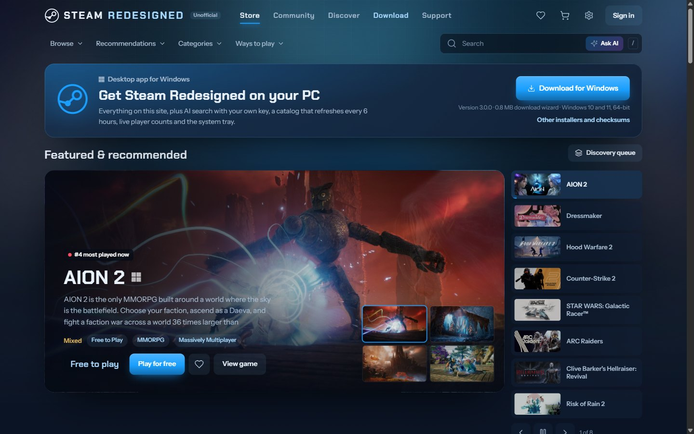
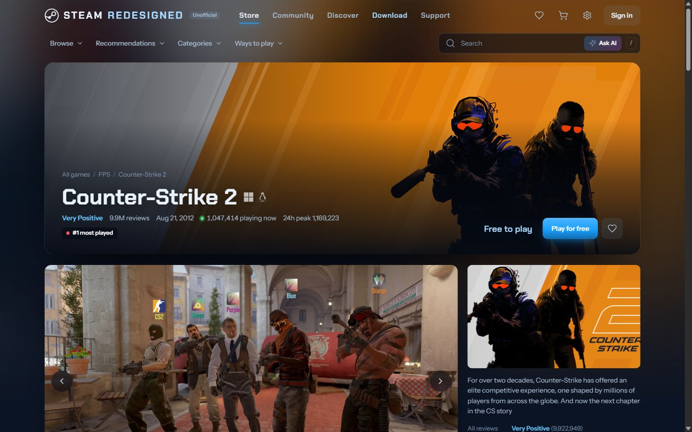
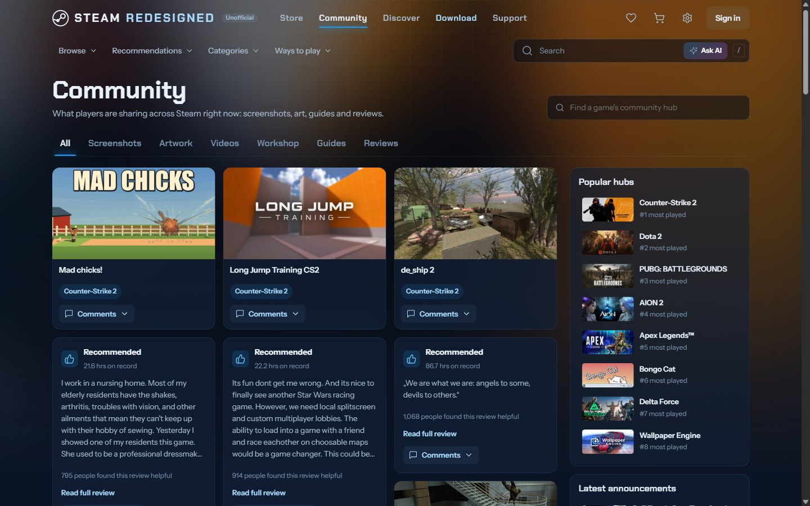
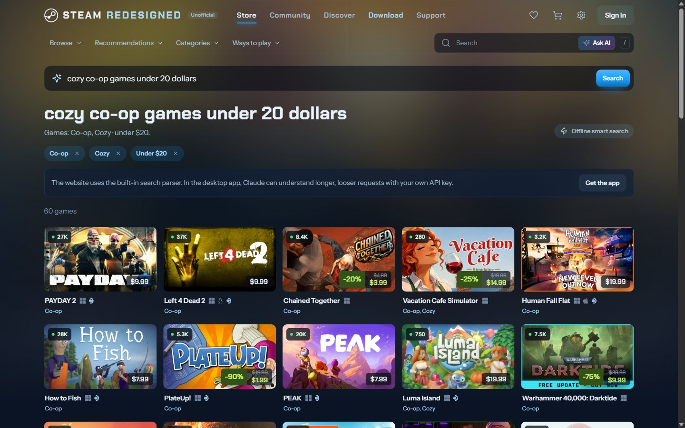
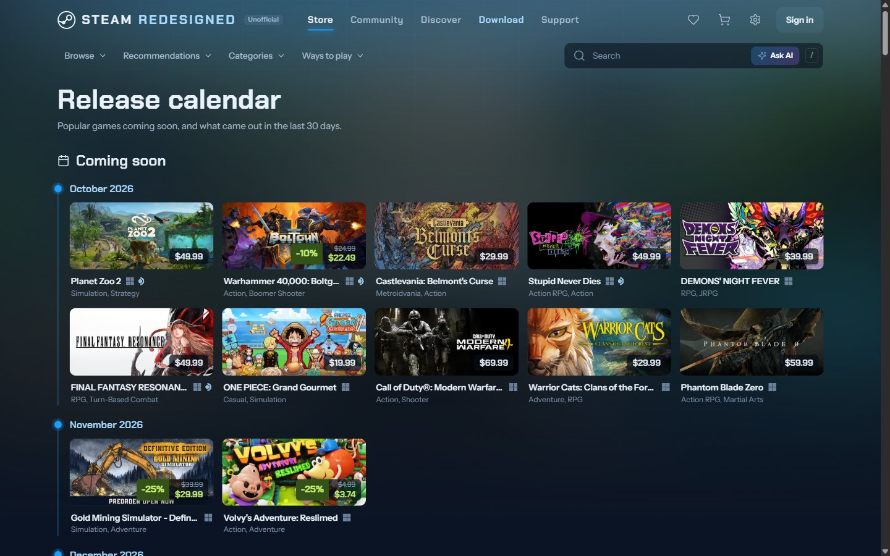

# Steam Redesigned (Project Vanguard)

An unofficial redesign of the Steam store and community, running on live Steam data. Use it as a Windows desktop app or in your browser.

**[Website](https://projection-of-vanguard.github.io)** · **[Web version](https://project-vanguard-pi.vercel.app)** · **[Download for Windows](https://github.com/Projection-Of-Vanguard/project-vanguard/releases/latest)**



| | |
|---|---|
|  |  |
|  |  |

## Download

Get the latest version from the **[releases page](https://github.com/Projection-Of-Vanguard/project-vanguard/releases/latest)**. It runs on Windows 10 and 11 (64-bit).

| File | What it is |
|---|---|
| `Steam-Redesigned-Setup-<version>.exe` | **Recommended.** A setup wizard under 1 MB. It downloads the app package from the release, checks its SHA-512 against the value built into the wizard, and installs. A package that fails the check is removed. |
| `Steam-Redesigned-<version>.msi` | Windows Installer package of the full app. |
| `Steam-Redesigned-Offline-Setup-<version>.exe` | Full app in one setup file, no download needed. |
| `steam-redesigned-<version>-x64.nsis.7z` | The package the wizard downloads. You don't need it yourself. |
| `SHA256SUMS.txt` | Checksums of all of the above. |

- All installers are per-user and need no administrator rights. They add Desktop and Start menu shortcuts and uninstall cleanly from Windows Settings › Apps.
- The installers aren't code-signed yet, because that needs a paid certificate. Windows SmartScreen will show "Windows protected your PC": choose **More info**, then **Run anyway**.
- Check a file is untouched with `certutil -hashfile <file> SHA256` and compare the result with `SHA256SUMS.txt`.

On a phone, a Mac or Linux, use the [web version](https://project-vanguard-pi.vercel.app). It has the same store, game pages, community and recommendations.

## App or website?

| | Windows app | Website |
|---|---|---|
| Store, game pages, community, recommendations | Yes | Yes |
| Catalog refresh | Every 6 hours, or on demand | Daily |
| AI search with Claude | Yes, with your own Anthropic API key | Built-in search only |
| Catalog size and player limit settings | Yes | No |
| System tray and notifications | Yes | No |
| Phones, Macs and Linux | No | Yes |

## Features

**Store**
- Every Steam game with **100+ players** (by 24-hour peak), up to 10,000, refreshed every 6 hours.
- **Update now** (top bar, title bar or tray) refreshes immediately with a progress ring.
- Official **Windows, Apple, Linux and Steam Deck logos** next to every game name.
- Live player counts, plus price and player history charts with the lowest recorded price.
- **Price alerts** on wishlisted games, and **compare** up to four games side by side.
- A **release calendar**, review filters (most helpful or recent, positive or negative) and fuzzy search with **AI search**.

**Recommendations** (the Recommendations menu, or "For you" in the title bar)
- A taste profile built from what you like, wishlist, own and open.
- Each pick explains why it's there.
- "More like this" and "Not interested" re-rank the list instantly.
- Pick favourite tags to start, and hide tags or owned games from the whole store.

**Community**
- Screenshots, art, videos, workshop items, guides, reviews, discussions and news.
- **Comment threads open in place with an animation.**

**Settings** (gear, top right, or Ctrl + ,)
- Themes, colours, background, notifications, accessibility, AI search, catalog and desktop options.
- **Animations** has a live preview: card hover styles for every card type, 7 page transitions, speed, cascades, parallax and carousel.
- **Community** has its own animations: card hover, feed entrance, viewer opening and comments opening.

## Security

Every install is fully independent. There is no connection between copies, no remote control, no auto-update channel, and no data sent anywhere except to Steam and, if you add a key, Anthropic.

**What the installers contain**
- Only the app's code, icons, fonts and a starter catalog of public Steam data. No keys, settings or personal data.

**Each copy's local data server**
- Listens on `127.0.0.1` only, so other devices on the network can't reach it.
- Rejects requests with a foreign `Host` header, which blocks DNS rebinding.
- Blocks cross-site reads, and requires same-origin plus a CSRF token for every change.
- Rate-limits every endpoint group and validates every parameter.
- Only fetches fixed Steam addresses. The comments endpoint accepts Steam Community item and review pages only.

**The desktop app**
- Runs with context isolation and a sandbox, with no Node.js in the page and a strict Content-Security-Policy.
- Denies all permission requests (camera, microphone, location and so on) and pins navigation to the app.
- External links open in the default browser.
- An Anthropic API key, if you add one, is encrypted with your Windows account.
- Installed builds quit when started with debugging flags, have Electron fuses off for Run-as-Node, `NODE_OPTIONS` and `--inspect`, load only from the packaged archive, and refuse to start if that archive was modified.

**The website**
- Read-only. Settings, the API key and manual refresh are desktop-only; the server answers those requests with 403.
- Holds no Anthropic key. Its storage token and cron secret are Vercel environment variables, never in the repository.
- Strict Content-Security-Policy, HSTS, no framing, no referrer, and a Permissions-Policy that turns off camera, microphone, location, payment and USB.
- Cross-site reads and cross-origin writes are refused, every endpoint group is rate-limited, and only `/api/*` reaches the server.
- A Vercel Cron job rebuilds the catalog once a day. Its endpoint only runs with the `CRON_SECRET` bearer token.

## Run it from source

Needs Node.js 24.

```bash
npm install
```

```bash
npm start
```

That starts the desktop app. To use it in a browser instead, run `node server.mjs` and open http://localhost:5173. The first start builds the catalog from Steam, which takes a few minutes.

## Release a new version

1. Raise `version` in `package.json`, and the version in `build.nsisWeb.appPackageUrl` to match.
2. `npm run dist` builds every installer into `dist/`. It needs a catalog in `data/`, so run the app once first.
3. `node tools/publish-web.mjs` uploads the installers to a GitHub Release (with the GitHub CLI), uploads starter data for the website to Vercel Blob, and writes `downloads.json` for both sites.
4. `node tools/build-pages.mjs` rebuilds the GitHub Pages site in `pages/`.
5. `node tools/build-web.mjs`, then `vercel deploy --prod` from `web/`, publishes the web version.

## Folder

| Path | What it is |
| --- | --- |
| `app/` | Desktop shell (main process and preload bridge) |
| `server.mjs` | Data server: local in the app, and the website's API in public mode |
| `index.html`, `styles.css`, `js/` | Interface |
| `assets/` | Icon, fonts, installer artwork and the wizard's integrity check (`installer.nsh`) |
| `tools/` | Installer build, publishing, website and GitHub Pages assembly, fuse hook, icon, fonts, shortcuts |
| `pages/` | The GitHub Pages site and screenshots |

Not in the repository: `data/` (each PC's catalog, history, cache and settings), `dist/` (built installers) and `web/` (generated by `tools/build-web.mjs`).

## Data sources

Steam store and Steam Web APIs, Steam Community, and SteamSpy (for discovering games only). SteamDB blocks automated access, so the app uses the same Steam data directly.

Steam Redesigned is an unofficial fan project and is not affiliated with Valve. Game names, art, prices and posts belong to their owners.
